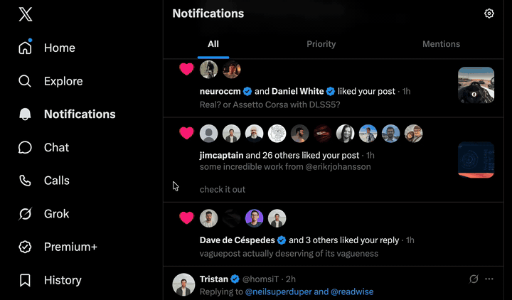

# Hovercraft

**Instant profile hover cards for X.** 
No half-second wait, no fade, and the card glides from profile to profile.

[Watch the full-quality video](docs/media/demo.mp4)

---

## Why

X's hover card waits about 600ms before it shows, fades in, waits again before it hides, and closes and reopens every time you move to the next profile. Sweeping across a row of avatars in your notifications feels like wading through mud.

Hovercraft replaces it with a card that keeps up with your mouse.

## Features

| | |
|---|---|
| ⚡ **Instant** | A slight 150ms delay on the first card so it doesn't pop as you pass by, then every switch is immediate. |
| 🛸 **Glides** | Moving to another profile slides the open card over and swaps its content, so it never closes and reopens. |
| 👋 **Gets out of the way** | Hides the moment you leave, unless you're heading into the card. |
| ✊ **Hold to follow** | Press and hold a profile or its card for a second to follow. The Follow button fills as you hold. |
| ⏩ **Hold for 2×** | Press and hold a playing video to watch at 2× speed, like the phone app. Let go to return to normal. |
| 📡 **No network wait** | Reads the profile data X already loaded for the page. |
| 🎨 **Native look** | Follow button, verified badges, "Follows you", bio, counts and "Followed by…". Matches Light, Dim and Lights out. |

## Install

Get it from the [Chrome Web Store](https://chromewebstore.google.com/detail/hovercraft/pbemffbaccogejhogjkehhaocjehdiek). Store installs update automatically.

To run from source instead:

1. Clone this repo, or download it as a ZIP and unzip it.
2. Open `chrome://extensions` and turn on **Developer mode**.
3. Click **Load unpacked** and pick the repo folder.
4. Refresh X.

Works in Chrome and other Chromium browsers (Arc, Brave, Edge, Helium, …).

## How it works

- `card.css` hides X's native hover card.
- `card.js` runs in the page so it can read X's React data for the hovered profile, then draws its own card in a shadow root.
- The "Followed by" row reuses the request X's hidden native card still makes.
- Follow/unfollow calls X's API with your existing session.

## Tweaking

Everything lives at the top of `card.js`:

| Setting | Default | What it does |
|---|---|---|
| `FIRST_REVEAL_MS` | `150` | Delay before the first card appears |
| `WARM_MS` | `300` | Re-hover within this long after a hide and the card shows instantly |
| `GLIDE` | `200ms` ease-out cubic | How the card slides between profiles |
| `HIDE_GRACE_MS` | `100` | Grace period while crossing into the card or to a neighboring profile |
| `NEAR_PX` | `16` | How far from a profile still counts as "between profiles" |

Colors are CSS variables (`--bg`, `--stroke`, `--outer`, …) in the same file.

## Caveats

X changes its markup and data often, so this can break. If a card doesn't show for someone, check the console for `[x-hovercard] no user data for <handle>` and [open an issue](https://github.com/nchudleigh/hovercraft/issues).

## Privacy

No data is collected or sent anywhere. See [PRIVACY.md](PRIVACY.md).

## License

[MIT](LICENSE)
